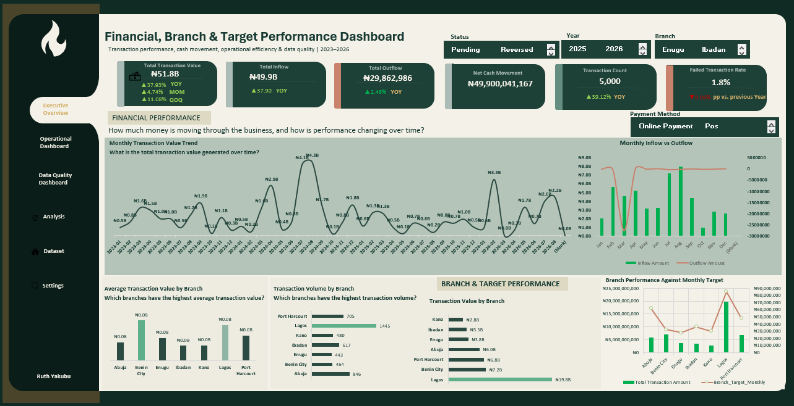
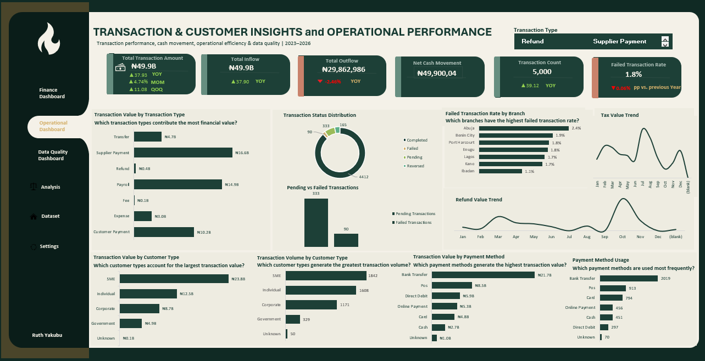
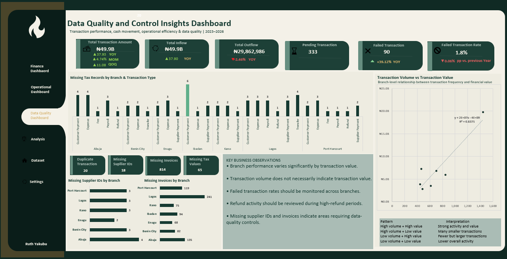

# Financial, Branch & Operational Performance Analysis
### An End-to-End Financial Analytics and Business Intelligence Project Using Microsoft Excel


## Project Overview

This project demonstrates an end-to-end financial and operational data analysis solution developed using Microsoft Excel.

The objective was to transform transactional data into meaningful business insights by analyzing financial performance, cash movement, branch contributions, customer activity, transaction efficiency, and data quality.

Using Excel, Power Query, the Excel Data Model, and DAX measures, I developed an interactive dashboard solution that enables management to monitor business performance, identify operational weaknesses, and make informed, data-driven decisions.

The project consists of three interconnected analytical dashboards:

1. Financial, Branch & Target Performance Dashboard
2. Transaction & Customer Insights and Operational Performance Dashboard
3. Data Quality & Control Insights Dashboard

**Reporting Period:** 2023–2026  
**Reporting Currency:** Nigerian Naira (₦)  
**Primary Technology:** Microsoft Excel

---

## Dashboard Preview

### 1. Financial, Branch & Target Performance Dashboard



Provides an executive overview of financial performance, transaction trends, branch contributions, cash movement, and target achievement.

### 2. Transaction & Customer Insights – Operational Dashboard



Examines transaction behavior, customer segments, payment methods, transaction categories, and operational efficiency.

### 3. Data Quality & Control Insights Dashboard



Highlights incomplete financial records, duplicate transaction identifiers, missing documentation, and potential weaknesses in data management controls.

---

## 1. Business Problem

Organizations generate large volumes of financial transactions across multiple branches, customer categories, payment channels, and transaction types.

However, transactional records alone do not provide management with a clear understanding of business performance.

Without proper analysis, organizations may struggle to:

- Monitor financial inflows and outflows.
- Identify branches contributing the most to revenue or transaction value.
- Understand changes in financial performance over time.
- Identify high-value customer segments.
- Monitor failed, pending, and reversed transactions.
- Evaluate the performance of different payment methods.
- Detect incomplete financial records and missing documentation.
- Identify operational inefficiencies and data quality risks.

This project addresses these challenges by developing an Excel-based analytical solution that combines financial reporting, operational monitoring, branch performance analysis, and data quality assessment.

## 2. Project Objectives

The major objectives were to:

- Analyze total transaction amount and transaction value.
- Monitor financial inflows, outflows, and net cash movement.
- Evaluate transaction performance across branches.
- Identify monthly and yearly transaction trends.
- Analyze financial contributions by transaction type and customer category.
- Evaluate payment method usage and transaction value.
- Monitor transaction status and failed transaction rates.
- Identify duplicate transactions and incomplete financial records.
- Provide actionable business recommendations based on analytical findings.

## 3. Key Business Questions

### Financial Performance
1. What is the total transaction value generated during the reporting period?
2. How much money flows into and out of the business?
3. What is the net cash movement?
4. How has transaction value changed monthly and yearly?
5. What are the year-over-year changes in inflow and outflow?
6. Which branches contribute the highest transaction value?

### Branch & Target Performance
1. Which branches generate the highest transaction value?
2. Which branches process the highest transaction volumes?
3. Does higher transaction volume necessarily translate into higher transaction value?
4. Which branches have the highest average transaction value?
5. How are branches performing against their monthly targets?
6. Which branches require additional management attention?

### Operational Performance
1. Which transaction types contribute the most financial value?
2. What is the distribution of completed, failed, pending, and reversed transactions?
3. Which branches record the highest failed transaction rates?
4. Which customer categories generate the highest transaction value?
5. Which customer categories process the most transactions?
6. Which payment methods generate the highest transaction value?
7. Which payment methods are used most frequently?
8. How does refund activity change over time?

### Data Quality & Control
1. How many duplicate transaction IDs exist?
2. How many records have missing supplier IDs?
3. How many invoices are missing?
4. How many transactions have missing tax values?
5. Which branches have the highest number of incomplete records?
6. Which branches and transaction types account for missing tax records?
7. What do these data quality issues indicate about financial documentation and internal controls?

## 4. Tools & Technologies

| Technology | Application |
|---|---|
| Microsoft Excel | Data analysis, calculations, and dashboard development |
| Power Query | Data cleaning, transformation, and preparation |
| Excel Data Model / Power Pivot | Data modelling and analytical calculations |
| DAX | Financial KPIs, time intelligence, and performance measures |
| Pivot Tables | Data summarization and business analysis |
| Pivot Charts | Interactive data visualization |
| Excel Slicers | Dashboard filtering and user interaction |

### Analytical Techniques
- Exploratory Data Analysis (EDA)
- Data Cleaning and Transformation
- Data Modelling
- Financial KPI Analysis
- Year-over-Year (YoY) Analysis
- Month-over-Month (MoM) Analysis
- Quarter-over-Quarter (QoQ) Analysis
- Branch Performance Benchmarking
- Trend Analysis
- Customer Segmentation
- Transaction Analysis
- Data Quality Assessment
- Target Performance Monitoring

## 5. Data Cleaning & Preparation

Data preparation was an important part of this project because the reliability of financial analysis depends on the quality of the underlying records.

Using Excel Power Query, I performed the following activities:

### Data Inspection
- Examined the dataset structure and column names.
- Identified missing values and inconsistent records.
- Reviewed transaction IDs and financial fields.
- Inspected transaction dates, categories, and status fields.

### Missing Value Treatment
Identified missing values in relevant fields, including:

- Transaction ID
- Customer ID
- Supplier ID
- Amount
- Tax Amount
- Invoice Number
- Notes

Missing tax amounts were replaced with zero for the transaction value calculation, while the original missing-tax condition was retained for data quality monitoring.

### Data Transformation
- Standardized relevant data types.
- Prepared transaction dates for time-based analysis.
- Reviewed categorical fields.
- Prepared financial values for aggregation.
- Created classifications to identify missing supplier IDs and invoice records.

### Multi-Currency Conversion Using Power Query

One of the major data preparation challenges was the presence of multiple currencies in the transaction dataset, including Nigerian Naira (NGN), US Dollars (USD), British Pounds (GBP), and Euros (EUR).

To ensure consistent financial reporting and meaningful comparisons across branches, transaction types, and payment methods, I created a separate currency lookup table in Power Query to standardize all financial values to Nigerian Naira (NGN).

Rather than replacing the original financial columns, I preserved the original transaction values and created additional NGN-converted columns. This maintained the original transaction information while providing standardized financial values for analysis.

**Step 1: Created a Currency Lookup Table**

I created a reference table containing the currency codes and their corresponding exchange rates against the Nigerian Naira.

| Currency | FX_Rate_NGN |
|---|---:|
| NGN | 1 |
| USD | 1,332 |
| EUR | 1,530 |
| GBP | 1,700 |

**Step 2: Merged the Lookup Table with the Fact Transactions Table**

Using Power Query's Merge Queries functionality, I merged the currency lookup table with the main Fact Transactions table using the Currency column as the matching key.

Since the Currency column already existed in the Fact Transactions table, I expanded only the `FX_Rate_NGN` column from the lookup table.

This introduced the applicable exchange rate into each transaction record without duplicating the existing currency column.

**Step 3: Created Additional NGN-Converted Columns**

Using Power Query's Add Column → Custom Column feature, I created the following calculated columns:

**1. Currency_Clean**

A standardized currency field used to ensure consistent currency codes for matching against the lookup table.

**2. FX_Rate_NGN**

The exchange rate retrieved from the currency lookup table after merging.

**3. Amount_NGN**

Converted the original transaction amount into Nigerian Naira.

```powerquery
[Amount] * [FX_Rate_NGN]
```

**4. Tax_Amount_NGN**

Converted the cleaned tax amount into Nigerian Naira.

```powerquery
[Tax_Amount_Clean] * [FX_Rate_NGN]
```

**5. Total_Transaction_Value_NGN**

Calculated the total transaction value in Nigerian Naira by adding the converted transaction amount and converted tax amount.

```powerquery
[Amount_NGN] + [Tax_Amount_NGN]
```

**Step 4: Preserved the Original Financial Columns**

The original `Amount`, `Tax_Amount`, and `Total_Transaction_Value` columns were retained.

The additional NGN columns were created separately to preserve the source currency values and provide a clear distinction between original financial records and standardized reporting values.

**Business Value of the Currency Conversion Process**

- Standardized transactions recorded in different currencies into a common reporting currency.
- Enabled consistent aggregation of financial values across branches and transaction categories.
- Improved the accuracy and comparability of financial KPIs.
- Preserved original transaction amounts and tax values for traceability.
- Created a reusable Power Query lookup table for currency conversion.
- Provided a consistent NGN reporting basis for the financial dashboards.

This transformation was an important part of preparing the dataset for financial analysis and dashboard development.

### Financial Data Preparation
Prepared transaction amounts in Nigerian Naira using the currency conversion assumptions applied in the project.

The transaction value calculation incorporated the transaction amount and tax amount:

**Total Transaction Value = Amount + Tax Amount**

### Data Quality Classification
Created analytical classifications to identify:
- Duplicate transaction identifiers.
- Missing supplier IDs.
- Missing invoice numbers.
- Missing tax values.

The objective was to retain visibility into data quality problems rather than simply remove incomplete records.

## 6. Data Analysis & DAX Measures

The Excel Data Model was used to support analytical calculations and KPI development through DAX.

The following are some of the key measures implemented in the project.

### Financial Performance Measures

**Total Transaction Amount**
```dax
Total Transaction Amount =
SUM(FactTransactions_1[Amount_NGN])
```

**Total Transaction Value**
```dax
Total Transaction Value =
SUM(FactTransactions_1[Total Transaction Value NGN])
```

**Transaction Count**
```dax
Transaction Count =
COUNTROWS(FactTransactions_1)
```

**Inflow Amount**
```dax
Inflow Amount =
CALCULATE(
    [Total Transaction Amount],
    FactTransactions_1[Transaction_Direction] = "Inflow"
)
```

**Outflow Amount**
```dax
Outflow Amount =
CALCULATE(
    [Total Transaction Amount],
    FactTransactions_1[Transaction_Direction] = "Outflow"
)
```

**Total Outflow Value**
```dax
Total Outflow Value =
ABS([Outflow Amount])
```

**Net Cash Movement**
```dax
Net Cash Movement =
[Inflow Amount] + [Outflow Amount]
```

### Transaction Monitoring Measures

**Failed Transactions**
```dax
Failed Transactions =
CALCULATE(
    [Transaction Count],
    FactTransactions_1[Status] = "Failed"
)
```

**Failed Transaction Rate**
```dax
Failed Transaction Rate =
DIVIDE(
    [Failed Transactions],
    [Transaction Count]
)
```

**Pending Transactions**
```dax
Pending Transactions =
CALCULATE(
    COUNTROWS(FactTransactions_1),
    FactTransactions_1[Status] = "Pending"
)
```

### Time Intelligence & Year-over-Year Analysis

**Previous Year Inflow**
```dax
Previous Year Inflow =
CALCULATE(
    [Inflow Amount],
    SAMEPERIODLASTYEAR('Date'[Transaction_Date])
)
```

**Inflow YoY %**
```dax
Inflow YoY % =
DIVIDE(
    [Inflow Amount] - [Previous Year Inflow],
    [Previous Year Inflow]
)
```

**Previous Year Transaction Amount**
```dax
Previous Year Transaction Amount =
CALCULATE(
    [Total Transaction Amount],
    SAMEPERIODLASTYEAR('Date'[Transaction_Date])
)
```

**YoY Change**
```dax
YOY Change =
[Total Transaction Amount]-[Previous Year Transaction Amount]
```

**YoY %**
```dax
YoY % =
DIVIDE(
    [YoY Change],
    [Previous Year Transaction Amount]
)
```

**Previous Year Outflow**
```dax
Previous Year Outflow =
CALCULATE(
    [Total Outflow Value],
    SAMEPERIODLASTYEAR('Date'[Transaction_Date])
)
```

**Outflow YoY %**
```dax
Outflow YoY % =
DIVIDE(
    [Total Outflow Value] - [Previous Year Outflow],
    [Previous Year Outflow]
)
```

### Transaction Efficiency

**Average Transaction Value**
```dax
Avg Transaction Value =
DIVIDE(
    [Total Transaction Amount],
    [Transaction Count]
)
```

These measures supported the dashboard's financial KPIs, transaction monitoring, and comparative performance analysis.

*Note: The formulas above represent selected measures used in the project. The complete workbook contains the associated analytical model and dashboard calculations. The Date table and its relationship to the transaction table support the time-intelligence calculations.*

## 7. Key Findings & Business Insights

The analysis revealed several important business insights.

### 1. Financial Performance Is Concentrated in Particular Branches

Lagos recorded the highest transaction value at approximately ₦19.8B.

Other branch contributions included:

| Branch | Transaction Value |
|---|---:|
| Lagos | ₦19.8B |
| Benin City | ₦7.2B |
| Port Harcourt | ₦6.8B |
| Abuja | ₦6.0B |
| Enugu | ₦3.8B |
| Ibadan | ₦3.5B |
| Kano | ₦2.8B |

**Insight:** Financial contributions vary significantly across branches. Lagos represents a major contributor to overall transaction value.

### 2. Transaction Volume Does Not Necessarily Translate into Higher Financial Value

The branch analysis showed that transaction frequency and transaction value do not always move together.

**Insight:** Evaluating branches using transaction count alone can create an incomplete picture of financial performance. Average transaction value should also be considered.

### 3. Supplier Payments and Payroll Are Major Transaction Categories

The transaction type analysis identified the following major contributors:

| Transaction Type | Transaction Value |
|---|---:|
| Supplier Payment | ₦16.6B |
| Payroll | ₦14.9B |
| Customer Payment | ₦10.2B |
| Transfer | ₦4.7B |
| Expense | ₦3.0B |

**Insight:** Supplier payments and payroll account for substantial transaction value and require appropriate monitoring and reconciliation.

### 4. SMEs Are the Largest Customer Segment by Transaction Value

| Customer Type | Transaction Value |
|---|---:|
| SME | ₦23.8B |
| Individual | ₦12.5B |
| Corporate | ₦8.7B |
| Government | ₦4.9B |
| Unknown | ₦0.1B |

**Insight:** SMEs are a significant contributor to the organization's transaction activity and represent an important segment for customer relationship management.

### 5. Transaction Failures Require Monitoring

The dashboard recorded:

| Transaction Status | Count |
|---|---:|
| Completed | 4,412 |
| Failed | 90 |
| Pending | 333 |
| Reversed | 165 |
| **Total** | **5,000** |

The overall failed transaction rate was 1.8%.

Abuja recorded the highest failed transaction rate at 2.4%, while Ibadan recorded the lowest at 1.1%.

**Insight:** Transaction failures should be investigated by branch, payment method, and transaction category to identify possible operational weaknesses.

### 6. Missing Invoices Represent a Significant Documentation Issue

A total of 814 missing invoice records were identified.

**Insight:** Incomplete invoice documentation can affect transaction verification, supplier reconciliation, and the reliability of financial reporting.

### 7. Other Data Quality Issues Identified

| Data Quality Indicator | Count |
|---|---:|
| Duplicate Transactions | 20 |
| Missing Supplier IDs | 18 |
| Missing Invoices | 814 |
| Missing Tax Values | 65 |

**Insight:** These issues highlight opportunities to strengthen transaction documentation, supplier identification, and financial data validation.

## 8. Business Recommendations

Based on the findings, the following actions are recommended.

| Business Area | Recommendation | Expected Benefit |
|---|---|---|
| Branch Performance | Investigate the factors driving Lagos's high transaction value and identify practices that can be replicated. | Improved branch performance |
| Financial Monitoring | Monitor inflows and outflows separately and perform regular reconciliations. | Better cash visibility |
| Transaction Failures | Investigate Abuja's higher failed transaction rate. | Improved transaction success |
| Supplier Management | Introduce mandatory supplier identification checks. | Improved accountability |
| Invoice Documentation | Strengthen invoice submission and verification processes. | Better financial documentation |
| Tax Management | Investigate records with missing tax values. | Improved tax reporting reliability |
| Duplicate Transactions | Establish transaction ID validation and investigation procedures. | Improved data integrity |
| Customer Strategy | Develop strategies to retain and grow the SME customer segment. | Improved customer value |
| Branch Benchmarking | Evaluate branches using transaction volume, transaction value, and average transaction value. | Balanced performance assessment |
| Target Monitoring | Review branch performance against monthly targets. | Improved target management |

## 9. Additional Analytical Considerations

This project also highlights important considerations for financial reporting and operational management.

- **Data integrity:** Incomplete financial records can affect the reliability of business reports.
- **Financial reconciliation:** Inflows, outflows, and net cash movement should be reconciled against underlying transaction records.
- **Performance measurement:** Transaction volume and transaction value should be evaluated together.
- **Operational risk:** Failed, pending, and reversed transactions require separate monitoring.
- **Data governance:** Data quality checks should be incorporated into routine financial reporting processes.

**Reporting limitation:** Missing tax amounts were treated as zero for the transaction value calculation, but this does not establish that the underlying tax liability is zero. The 65 affected records require further validation.

The dashboard figures are analytical outputs and should be reconciled against source records before formal financial reporting.

## 10. Skills Demonstrated

This project demonstrates practical experience in:

- Microsoft Excel for business analytics.
- Power Query for data cleaning and transformation.
- Excel Data Model and Power Pivot.
- DAX measures and time intelligence.
- Financial KPI development.
- Pivot Tables and Pivot Charts.
- Interactive Excel dashboard development.
- Financial and operational performance analysis.
- Branch performance benchmarking.
- Customer and transaction segmentation.
- Data quality assessment.
- Business insight generation.
- Translating analytical findings into business recommendations.

## 11. Project Deliverables

The project includes:

1. Excel workbook containing the analysis and interactive dashboards.
2. Financial, branch, and target performance dashboard.
3. Transaction and customer insights dashboard.
4. Data quality and control insights dashboard.
5. DAX measures supporting the analytical KPIs.
6. Business findings and management recommendations.

## 12. Conclusion

This project demonstrates how Microsoft Excel can be used beyond basic spreadsheets to develop a comprehensive business intelligence solution.

By combining Power Query, data modelling, DAX, Pivot Tables, and interactive visualizations, I transformed transactional records into insights that support financial monitoring, branch performance evaluation, operational efficiency, and data quality management.

The project reflects my approach to data analytics: understanding the business problem, preparing reliable data, developing meaningful KPIs, identifying patterns, and translating findings into practical business recommendations.

**The goal is not just to report numbers, but to help businesses understand their performance and make better decisions.**

---

**Project:** Financial, Branch & Operational Performance Analysis  
**Role:** Data Analyst  
**Developer:** Ruth Yakubu  
**Technology:** Microsoft Excel | Power Query | Excel Data Model | Power Pivot | DAX
